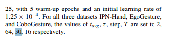
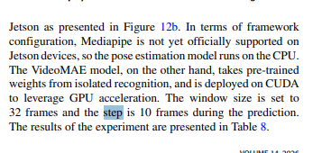
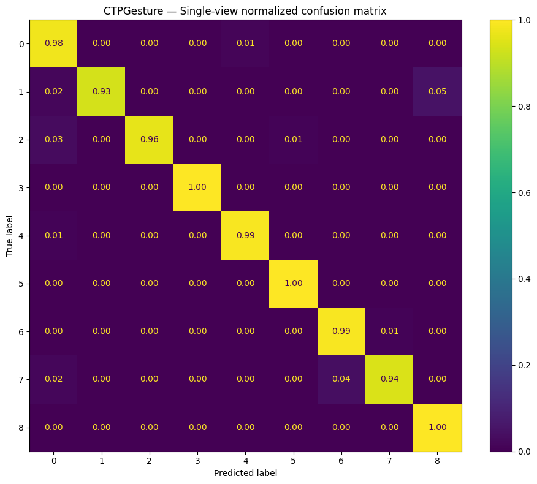

# Báo cáo kết quả nghiên cứu ngày 08/10/2026

## A. Công việc đã làm 
- Triển khai khảo sát lại các mức min_gesture_sec và arg_sec tối ưu Accuraccy.
- Train model Videomamba với CTPGesturev1 dataset và đánh giá 
- Chạy infrence VideoMAEv1-v2 và so sánh các thông số .

### 1. Khảo sát lại các mức min_gesture_sec và arg_sec tối ưu Accuraccy tại bước Postprocessing

- Cấu hình theo bài báo: 64 frame/window , 30 step --> mức độ overlap là 1 - 30/60 = ~53 % 
- Tuy nhiên khi thực nghiệp trên jetson người da ddùng :  32 frames/window , step = 10 -> mức độ overlap = ~68% 

- Cấu hình thực nghiệm triển khai : Window = 64 frames, Step = 16, Overlap = 75% (IPN-Hand test split, 1610 annotations, 200 video)
- Bảng so sánh đánh giá các cấu hình configuration: 

**Pipeline post-processing gồm 4 stage tuần tự như sau :** 

Linking (T_AVG) -> Short-segment Removal (MIN_GESTURE) -> Fill same neighbors -> Smoothing

| Config | Smoothing | T_AVG (s) | MIN_GESTURE (s) | Fill | Mean FrameAcc | Global FrameAcc | Temporal Overlap | Gesture Recall | Δ FrameAcc | Δ Overlap | Δ Recall |
|--------|-----------|-----------|-----------------|------|:-------------:|:---------------:|:----------------:|:--------------:|:----------:|:---------:|:--------:|
| **R3 (BEST result)** | False | 0.7 | **1.0** | False | **0.8352** | 0.8377 | 0.5077 | 0.7628 | +0.0004 | +0.0166 | -0.0262 |
| F1 | False | 0.7 | 1.0 | True | **0.8352** | 0.8377 | 0.5077 | 0.7628 | +0.0004 | +0.0166 | -0.0262 |
| R2 | False | 0.7 | 0.7 | False | 0.8351 | 0.8376 | 0.5077 | 0.7638 | +0.0003 | +0.0166 | -0.0252 |
| L2 | False | **0.7** | 0.0 | False | 0.8350 | 0.8375 | 0.4926 | 0.7872 | +0.0002 | +0.0015 | -0.0018 |
| L3 | False | **1.0** | 0.0 | False | 0.8350 | 0.8375 | 0.4926 | 0.7872 | +0.0002 | +0.0015 | -0.0018 |
| R1 | False | 0.7 | 0.5 | False | 0.8350 | 0.8375 | 0.4926 | 0.7872 | +0.0002 | +0.0015 | -0.0018 |
| Raw | False | 0.0 | 0.0 | False | 0.8349 | 0.8373 | 0.4911 | **0.7890** | baseline | baseline | baseline |
| L1 | False | 0.3 | 0.0 | False | 0.8349 | 0.8373 | 0.4911 | 0.7890 | +0.0000 | +0.0000 | +0.0000 |
| S1 | **True** | 0.7 | 1.0 | False | 0.8345 | 0.8371 | 0.5040 | 0.7510 | -0.0004 | +0.0128 | -0.0380 |
| S2 | **True** | 0.7 | 1.0 | True | 0.8345 | 0.8371 | 0.5040 | 0.7510 | -0.0004 | +0.0128 | -0.0380 |
| R4 | False | 0.7 | 1.5 | False | 0.8333 | 0.8357 | **0.5115** | 0.7248 | -0.0016 | +0.0204 | -0.0642 |

**Cấu hình tốt nhất (R3):** `T_AVG = 0.7s`, `MIN_GESTURE = 1.0s`, Smoothing = False, Fill = False  
**Nhận xét chung:**
- Smoothing làm giảm cả FrameAcc lẫn Recall so với raw output khi chưa có post-processing.
- MIN_GESTURE = 1.0s là điểm cân bằng tốt hơn so với các mức khác: lọc 94 segments ngắn nhiễu, Overlap tăng +1.66% so với Raw output without Post-processing. ( tuy theo em nghĩ nó sẽ tùy thuộc vào từng video , mỗi video tùy tường người thực hiện sẽ có tốc độ thực hiện gesture khác nhau 1 chút)
- Tăng MIN_GESTURE lên 1.5s (R4): Overlap tối ưu nhất (51.15%) nhưng Recall giảm hơn -6.4%.
- Mức T_AVG thấp (khoảng 0.3) không có tác dụng linking, cần khoảng 0.7s trở lên mới có hiệu quả.

### 2. Chạy infrecne model VideoMAE v1 v2 và so sánh với VideoMamba

- So sánh kiến trúc trên cùng input `1×3×16×224×224`, FP32, 14-class head, GPU CUDA(Kaggle server- TestLa4 2xGPU). 
- VideoMAE v1/v2 dùng kiến trúc downstream ViT-L/16 (Vission Transformer), VideoMamba-Tiny dùng checkpoint IPN-Hand ( chỉ chạy infrence lấy thông số latency, params,FLOPs ,...)

| Model | Params (M) | GFLOPs/clip | Tokens | Layers | Mean Latency (ms) | P95 Latency (ms) | Throughput (clips/s) | Peak VRAM (MiB) | Backend | Params vs VM | GFLOPs vs VM | Latency vs VM |
|-------|:----------:|:-----------:|:------:|:------:|:-----------------:|:----------------:|:--------------------:|:---------------:|---------|:------------:|:------------:|:-------------:|
| **VideoMamba-Tiny** | **6.96** | **29.03** | 3137 | 24 | **48.5** | **49.4** | **20.6** | 26.6+56.6 | native_cuda | 1.00× | 1.00× | 1.00× |
| VideoMAE v1 ViT-L/16 | 303.88 | 596.83 | 1568 | 24 | 484.9 | 494.8 | 2.06 | 1159.2+336.9 | PyTorch ViT | 43.66× | 20.56× | 10.00× |
| VideoMAE v2 ViT-L/16 | 303.88 | 596.83 | 1568 | 24 | 459.3 | 461.9 | 2.18 | 1159.2+336.9 | PyTorch ViT | 43.66× | 20.56× | 9.48× |

**Nhận xét:**
- VideoMamba-Tiny nhẹ hơn **~43.7×** về params và **~20.6×** về GFLOPs so với VideoMAE ViT-L/16
- Latency thấp hơn **~10×** so với VideoMAE v1, **~9.5×** so với VideoMAE v2 với cùng input và thiết bị test ( Kaggle CPU testla4)
- VideoMamba-Tiny đạt throughput **20.6 clips/s** so với ~2.1 clips/s của VideoMAE → phù hợp real-time deployment

### 3. Train model VideoMamba với CTPGesturev1 datasets và đánh giá kết quả

#### 3.1. Dataset CTPGesture_v1

| Thông tin | Giá trị |
|-----------|---------|
| Tên dataset | **CTPGesture_v1** |
| Số lớp | 9 (`0 = No Gesture`, `1..8 = traffic-police gestures`) |
| Tổng số video | 21 |

**Phân chia dữ liệu:**

| Split | Videos | Segments | Annotated Frames | Tỷ lệ |
|-------|:------:|:--------:|:----------------:|:------:|
| **Train** | 8 (`001, 005, 007, 009, 013, 015, 017, 103`) | 1,284 | 51,824 | 38.5% |
| **Val** | 2 (`003, 011`) | 342 | 15,244 | 11.3% |
| **Test** | 11 (`002, 004, 008, 010, 012, 014, 016, 018, 101, 102, 104`) | 1,728 | 67,356 | 50.1% |
| **Tổng** | 21 | 3,354 | 134,424 | 100% |

- Dataset đã được chia sẵn train và test folder : em tách train folder thành train và val để chạy .
- Val chiếm **22.73%** tổng annotated frames của provider-train (15,244 / 67,068).
- Test gồm 1,728 segments × 12 views (4 temporal × 3 spatial crops) = **20,736 test views**.

#### 3.2. Cấu hình Training

| Hyperparameter | Giá trị |
|----------------|---------|
| Model | **VideoMamba-Tiny** (6.96M params) |
| Pretrained | `videomamba_t16_in1k.pth` (ImageNet-1K) |
| Input | `1×3×16×224×224` (16 frames, sampling rate 2) |
| Patch size | `16×16`, Tubelet size = 1 |
| Optimizer | AdamW (`β₁=0.9, β₂=0.999, ε=1e-8`) |
| Learning rate | `1e-4` (absolute, không auto-scale theo batch) |
| LR Schedule | Cosine decay → `min_lr=1e-6` |
| Warmup | 5 epochs (warmup_lr = `1e-6` → `1e-4`) |
| Weight decay | 0.05 (layer decay = 0.75) |
| Epochs | 30 (thực tế chạy được 28/30) |
| Gradient clipping | `max_norm=1.0` |
| Effective batch size | **8** (2 GPUs × batch 2 × update_freq 2) |
| Precision | **FP32** (no AMP) |
| Augmentation | RandAugment (`m5-n2`), ColorJitter=0.4, RandomErasing(`p=0.25`) |
| Mixup / CutMix | OFF / OFF |
| Label smoothing | 0.0 |
| FC Dropout | 0.3 |
| DropPath | 0.1 |
| Loss function | CrossEntropyLoss |
| Horizontal flip | **OFF** (các gesture cần phân biệt trái/phải) |
| Hardware | 2× Tesla T4 (Kaggle), DDP with NCCL backend |

#### 3.3. Kết quả Training (28 Epochs)

**Quá trình training bị timeout và dừng tại Epoch 29/30** do Kaggle giới hạn session tối đa 12 tiếng liên tục. Tuy nhiên, checkpoint tốt nhất (best accuracy) đã được lưu tự động tại Epoch 18.

| Epoch | Train Loss | Train Acc | Val Loss | Val Acc | Best | LR | Ghi chú |
| Epoch | Train Loss | Train Acc | Val Loss | Val Acc | Best | LR | Ghi chú |
|:-----:|:----------:|:---------:|:--------:|:-------:|:----:|:--:|---------|
| 1 | 2.0191 | 33.8% | 1.7178 | 50.3% | 50.3% | 1.09e-05 | Khởi đầu (Warmup) |
| 5 | 0.5631 | 84.6% | 0.5259 | 83.9% | 83.9% | 9.01e-05 | Kết thúc Warmup|
| **7** | **0.4675** | **86.9%** | **0.4257** | **87.4%** | **87.4%** | 9.91e-05 | **First best**  |
| 12 | 0.3958 | 89.5% | 1.0169 | 77.5% | 87.4% | 8.44e-05 | **Val loss tăng cao hơn train loss** |
| **18** | **0.3610** | **91.2%** | **0.2325** | **92.1%** | **92.1%** | **5.05e-05** | **BEST CHECKPOINT** |
| 26 | 0.2335 | 94.0% | 0.3970 | 90.9% | 92.1% | 8.74e-06 | **Train Acc cao nhất** |
| 28 | 0.2540 | 93.4% | 0.3838 | 90.6% | 92.1% | 3.46e-06 | Epoch cuối trước khi lôix do hết hạn runtime kaggle |

#### 3.4. Tổng kết & Nhận xét

| Metric | Giá trị | Epoch |
|--------|:-------:|:-----:|
| **Best Val Acc** | **92.1%** | 18 |
| Best Val Loss | 0.2325 | 18 |
| Best Train Acc | 94.0% | 26 |
| Lowest Train Loss | 0.2335 | 26 |
| Final Overfitting Gap | ~2.8% | 28 |

#### 3.5. Đánh giá Model trên tập Test (Offline Trimmed Evaluation)

- Sau khi lấy được `checkpoint-best.pth` tại Epoch 18, em đánh giá lại độ chính xác trên tập **Test đã cắt sẵn (11 videos, 1,728 segments, 20,736 test views)**. Ở bước đánh giá tĩnh này, dữ liệu đầu vào của model vẫn là `16 frames` giống như lúc train. 

> Hiện tại vì dataset là các video khá dài, khoảng 6-15p cho một video dataset với FPS là 30 thì em tạm thời dùng cách trích xuất ra 16 frame để test isolated trước ạ, vì nếu chạy sliding window + overlap 75% thì khả năng sẽ mất thời gian hơi nhiều ạ , tuần này em train gần hết giới hạn runtime của kaggle mất ạ.

- 2 phương pháp lấy mẫu (testing protocol) được sử dụng để trích xuất 16 frames từ một segment:

- **Single View:** 
  - Chỉ trích xuất 1 clip chứa 16 frames nằm ở chính giữa đoạn video.     
- **12-View (4 temporal × 3 spatial crops):** 
  - Chia đoạn 120 frames làm 4 mốc (đầu, giữa-trước, giữa-sau, cuối), tại mỗi mốc lấy ra 16 frames. 
  - Tại mỗi cụm 16 frames, lại crop 3 góc khác nhau: Lệch trái, Chính giữa, và Lệch phải.

**1. Kết quả:**

| Phương pháp lấy mẫu | Accuracy | Balanced Acc | Macro F1 | Weighted F1 | Top-5 Acc | GFLOPs / Sample |
|-----------|:--------:|:------------:|:--------:|:-----------:|:---------:|:---------------:|
| **Single View** | 97.92% | 97.80% | 97.45% | 97.93% | - | 17.19 |
| **12-View** | **98.50%** | **98.38%** | **98.01%** | **98.50%** | **100.00%** | 206.28 |

**2. Confusion Matrix:**

| Single View | 12-View |
|:---:|:---:|
|  |  |

- **Nhận xét chủ quan:**
    - Các hành động rõ ràng, toàn thân như các gesture trong dataset CTPGesture thì có thể được phân loại tốt hơn so với các hành động cử chỉ tay nhỏ như **finger 2 point** hay **finger 1 point** trong IPN Hand .

## B. Khó khăn 
- Hiện tại việc train model lại với dataset lớn như CTPGesturev1 ( Version2 > version1, và cả EgoEvGesture) tốn quá thời lượng 12 tiếng runtime của Kaggle nên em không train hết được ạ.
## C. Công việc tiếp theo 
- Một số công việc em còn chưa hoàn thiện như sau : 
    - Chạy inference đánh giá thêm continuos evaluation trên dataset CTPGesturev1 với checkpoint-best mới train. 
    - Chạy train model VideoMambaTiny với EgoEv Gesture dataset và đánh giá kết quả Isolated và Continouse Evaluation với các metric tương tự.
- Em xin phép nhận hướng đi tiếp theo từ Thầy ạ.