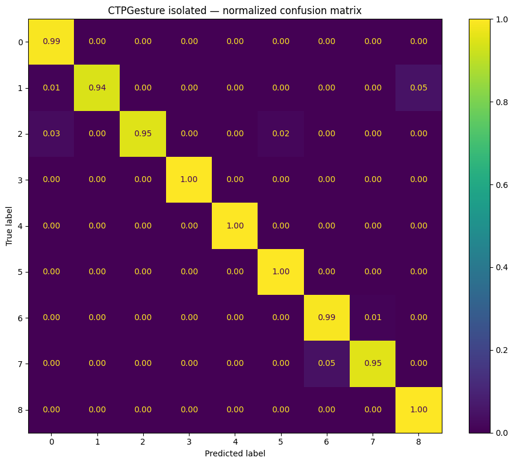
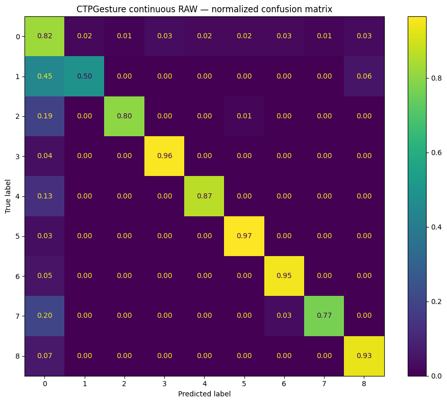

# Báo cáo nghiên cứu ngày 15/10/2026 

## A. Công việc đã làm 
- Chạy inference đánh giá thêm continuos evaluation trên dataset CTPGesturev1 với checkpoint-best mới train.  

- Tìm kiếm các bài báo liên quan tới CTPGestur V1 , thu thập kết quả và so sánh 

### 1. Chạy inference đánh giá thêm continuos evaluation trên dataset CTPGesture 
- Cấu hình thử nghiệm : 

| Tham số | Giá trị |
|---|---|
| Model | VideoMamba-Tiny (6,959,817 params) |
| Checkpoint | checkpoint-best.pth (epoch 17) |
| GPU | Tesla T4 |
| Mamba backend | native_cuda |
| FPS video | 15 FPS |
| Window size | 32 frames (~2.13 s) |
| Window step | 8 frames (overlap 75%) |
| Model input frames | 16 frames |
| Sample offsets | 0, 2, 4, ..., 30 |

> Vì FPS của Video trong CTPGesture là 15FPS , nên để đảm bảo tốc độ chênh lệch giữa các frame thì em tạm thời giảm Window từ 64 -> 32

- Kết quả :

#### 1.1. Isolated Gesture Classification
> Ground-truth boundaries -> sample 16 frames đều -> 1 dự đoán/segment, không dùng sliding window.

| Metric | Tất cả lớp (0-8) | Gesture-only (1-8) |
|---|---|---|
| Samples | 1,728 | 859 |
| **Accuracy** | **98.55%** | **98.02%** |
| **Balanced Accuracy** | **98.12%** | **98.00%** |
| Macro Precision | 97.87% | 98.54% |
| Macro Recall | 98.12% | 98.00% |
| **Macro F1** | **97.96%** | **98.24%** |
| Weighted F1 | 98.55% | 98.24% |

**Per-class F1 nổi bật:**

| Lớp | F1-score |
|---|---|
| 0 - No Gesture | 0.9931 |
| 1 - Stop | 0.9662 |
| 2 - Forward | 0.9758 |
| **3 - Left Turn** | **1.0000** |
| 4 - Left Turn Waiting | 0.9912 |
| 5 - Right Turn | 0.9907 |
| 6 - Lane Changing | 0.9640 |
| 7 - Slow Down | 0.9668 |
| 8 - Pull Over | 0.9686 |

**Confusion matrix (normalized):**

#### 1.2. Continuous Recognition (raw, chưa post-processing)
> Sliding window 32/8 trên toàn bộ video -> xác suất frame-level -> argmax.

| Metric | Giá trị |
|---|---|
| Videos | 11 |
| Tổng frames | 67,356 |
| Tổng windows | 8,392 |
| **Global Frame Accuracy** | **83.98%** |
| **Global Balanced Accuracy** | **84.00%** |
| Global Macro F1 | 80.61% |
| Global Weighted F1 | 83.96% |
| **Mean Gesture Recall** | **94.80%** |
| **Mean Temporal Overlap** | **65.32%** |
| Mean model ms/window | 48.2 ms |
| Effective windows/second | 8.67 |

**Confusion matrix (normalized):**

#### 1.3. Hậu xử lí raw output (Post-processing)

> Pipeline post-processing gồm 4 stage tuần tự: Linking (T_AVG) -> Short-segment Removal (MIN_GESTURE) -> Fill same neighbors -> Smoothing. Model chỉ chạy inference một lần để trích xuất raw cache, các bước sau xử lý trực tiếp trên probability cache.

**Bảng so sánh các cấu hình Post-processing:**

| Config | Smoothing | T_AVG (s) | MIN_GESTURE (s) | Fill | Global FrameAcc | Global Macro F1 | Temporal Overlap | Gesture Recall | Δ FrameAcc | Δ Overlap | Δ Recall |
|---|:---:|:---:|:---:|:---:|:---:|:---:|:---:|:---:|:---:|:---:|:---:|
| **R3 (BEST)** | False | 0.0 | **1.0** | False | **83.99%** | **80.63%** | **65.90%** | 94.45% | +0.01% | +0.58% | -0.35% |
| F1 | False | 0.0 | 1.0 | True | 83.99% | 80.63% | 65.90% | 94.45% | +0.01% | +0.58% | -0.35% |
| **Raw (Baseline)** | False | 0.0 | 0.0 | False | 83.98% | 80.61% | 65.32% | **94.80%** | baseline | baseline | baseline |
| L1 | False | 0.3 | 0.0 | False | 83.98% | 80.61% | 65.32% | 94.80% | +0.00% | +0.00% | +0.00% |
| R1 | False | 0.0 | 0.5 | False | 83.98% | 80.61% | 65.32% | 94.80% | +0.00% | +0.00% | +0.00% |
| R2 | False | 0.0 | 0.7 | False | 83.98% | 80.61% | 65.82% | 94.45% | -0.01% | +0.50% | -0.35% |
| L2 | False | 0.7 | 0.0 | False | 83.97% | 80.60% | 65.26% | 94.68% | -0.01% | -0.06% | -0.13% |
| L3 | False | 1.0 | 0.0 | False | 83.97% | 80.60% | 65.26% | 94.68% | -0.01% | -0.06% | -0.13% |
| S2 | True | 0.0 | 1.0 | True | 83.82% | 79.75% | 64.97% | 91.57% | -0.16% | -0.35% | -3.23% |
| S1 | True | 0.0 | 1.0 | False | 83.81% | 79.71% | 64.85% | 91.57% | -0.18% | -0.47% | -3.23% |
| R4 | False | 0.0 | 1.5 | False | 83.85% | 79.67% | 64.87% | 90.39% | -0.14% | -0.46% | -4.41% |

**Nhận xét và Phân tích:**
- **Cấu hình tối ưu nhất là R3**: `MIN_GESTURE = 1.0s`, `T_AVG = 0.0s`, Smoothing = False, Fill = False. Đã loại bỏ 12 đoạn dự đoán ngắn nhiễu, tăng Temporal Overlap thêm **+0.58%** (đạt 65.90%), Frame Accuracy tăng nhẹ lên **83.99%**.
> **Post-processing trên CTPGesture ít thay đổi hơn so với IPN-Hand**: Do cử chỉ của CSGT là các động tác cơ thể lớn, dứt khoát và kéo dài trong khoảng thời gian xác định, ít bị phân mảnh thành nhiều đoạn nhỏ như các vi cử chỉ tay (micro-gestures) ở IPN-Hand.
- **Probability Smoothing (S1, S2) làm giảm hiệu năng**: Khi làm mượt xác suất theo thời gian, ranh giới giữa các cử chỉ bị mờ (boundary blur), dẫn đến Macro F1 giảm từ 80.61% xuống **79.71%** và Recall giảm **-3.23%**.
- **Linking (T_AVG) không đem lại hiệu quả**: `T_AVG = 0.0s` cho kết quả tốt nhất; khi tăng T_AVG (ghép các đoạn cùng nhãn cách nhau < 0.7s - 1.0s), mô hình phân biệt không rõ ràng được giữa 2 lần thực hiện cử chỉ liên tiếp tại biên của 2 cử chỉ 

### 1.4. Computational complexity và runtime benchmark 
| Thông số | Kết quả | Phạm vi đo / điều kiện |
|---|---:|---|
| Model | VideoMamba-Tiny | 24 layers, 3.137 tokens/clip |
| Input model | 1 × 3 × 16 × 224 × 224 | RGB, FP32 |
| Parameters | **6.959.817 (6,96M)** |
| Parameter storage (FP32) | 26,55 MiB |
| **Estimated computation** | **29,026 GFLOPs/clip** |  |
| Checkpoint file size | 80,14 MiB | |

### 2. Các nghiên cứu đối chứng trên CTPGesture v1 / Police Gesture Dataset

#### 2.1. Thông tin công bố, venue và xếp hạng

| Mã | Bài báo, năm | Venue | Xếp hạng có ghi rõ hệ và năm | PDF bài báo|
|---|---|---|---|---|
| [P1] | Xiong et al., **2021**, *Traffic Police Gesture Recognition Based on Gesture Skeleton Extractor and Multichannel Dilated Graph Convolution Network* | **Electronics** (MDPI), 10(5):551 | **JCR 2021: Q3**; JCR 2025: **Q2** (ngành Engineering, Electrical and Electronic). SJR 2021: Q2 | [electronics-10-00551-v2.pdf](electronics-10-00551-v2.pdf) |
| [P2] | Xiao, Li & Zhao, **2025**, *A Lightweight and Efficient Gesture Recognizer for Traffic Police Commands Using Spatiotemporal Feature Fusion* | **Scientific Reports** (Nature Portfolio), 15:18256 | **JCR 2025: Q1** (Multidisciplinary Sciences) | [s41598-025-02833-y.pdf](s41598-025-02833-y.pdf) |
| [P3] | Zhang et al., **2026**, *A Traffic Police Gesture Recognition Method Based on BiLSTM-Transformer Architecture* | **Electronics** (MDPI), 15(12):2578 | **JCR 2025: Q2** (ngành Engineering, Electrical and Electronic; dùng dữ liệu JCR hiện có trước công bố 2026) | [electronics-15-02578.pdf](electronics-15-02578.pdf) |
| [P4] | Li, Gao & Fu, **2026**, *RSC-GestureNet: Reliability-Aware Selective Causal Recognition of Chinese Traffic Police Gestures* | **arXiv:2608.02200v1** | **Preprint** | [2608.02200v1.pdf](2608.02200v1.pdf) |

#### 2.2. Phương pháp, đóng góp và bằng chứng trích dẫn trong từng bài

##### **[P1] Xiong et al. (2021) — GSE + MD-GCN**
* **Phương pháp & Kiến trúc:**
  * Dùng **Gesture Skeleton Extractor (GSE)** nhằm loại bỏ các khớp không hữu ích.
  * Đưa đặc trưng pose vào **Multichannel Dilated Graph Convolution Network (MD-GCN)** với nhiều dilation rates để học quan hệ không gian–thời gian.
  * Trọng tâm bài là Skeleton/GCN, nhưng có bảng đối chứng quan trọng với các mô hình RGB 3D.
* **Tập dữ liệu & Phân chia:**
  * Tổng cộng **20 video**; chia **11 train** (1.789 gesture clips) và **9 test** (1.565 gesture clips).
  * Dữ liệu được cắt (clip) dựa trên annotation sẵn có (*Section 6.1, trang in 9/14*).
* **Kết quả công bố (*Section 6.3, Table 3, trang in 12/14*):**
  * **MD-GCN (đề xuất):** **98,95%** Accuracy.
  * **Baselines RGB (tác giả P1 tự re-evaluate):** Hara/3D ResNet: **81,16%** | Tran/C3D: **87,12%** | Qiu/P3D: **92,21%**.
* **Nguồn & Tài liệu:** [MDPI Electronics (2021)](https://www.mdpi.com/2079-9292/10/5/551) | PDF: [electronics-10-00551-v2.pdf](electronics-10-00551-v2.pdf).

---

##### **[P2] Xiao et al. (2025) — NTPGR**
* **Phương pháp & Kiến trúc:**
  * **EPFFNet** trích xuất keypoints và xây dựng đặc trưng góc / khoảng cách.
  * **MSNet** học chuỗi thời gian thông qua 3 nhánh song song: **CNN + LSTM sequence + temporal/channel attention** (*Abstract; Fig. 1; Methods, trang in 1–4/19*).
* **Tập dữ liệu & Phân chia:**
  * Đánh giá trên **10 video** với tổng số **778 gesture instances** (nhận dạng đúng 759).
  * Phần thực nghiệm ghi dữ liệu là *"21 short videos"*, có sai khác metadata so với tập 20 video gốc và notebook của nhóm $\rightarrow$ cần xem là **related dataset**, chưa chứng minh cùng cách chia.
* **Kết quả công bố:**
  * **Accuracy:** **97,56%** (759/778 instances) (*Table 2, trang in 11/19*).
  * **Thời gian phản hồi:** **0,76 s** average response time trên GTX TITAN XP (*Table 4 & phân tích trang in 14/19*).
  * Đối chiếu sequence/composite baselines chi tiết tại *Table 3, trang in 13/19*.
* **Lưu ý đối chứng:**
  * Đơn vị đánh giá là **Gesture Instance**, không tương đương với frame-level hay isolated clip của các nghiên cứu khác.
  * Độ trễ 0,76 s là trên GPU TITAN XP, không phản ánh latency model-only trên Tesla T4.
* **Nguồn & Tài liệu:** [Scientific Reports (Nature Portfolio 2025)](https://www.nature.com/articles/s41598-025-02833-y) | PDF: [s41598-025-02833-y.pdf](s41598-025-02833-y.pdf).

---

##### **[P3] Zhang et al. (2026) — YOLOv11m-Pose + BiLSTM–Transformer**
* **Phương pháp & Kiến trúc:**
  * **YOLOv11m-Pose** trích xuất **17 keypoints/frame**, gom chuỗi **40 frame**.
  * Kết hợp **BiLSTM** (học quan hệ cục bộ) và **Transformer self-attention** (học phụ thuộc xa) (*Section 3, Fig. 5*).
* **Tập dữ liệu & Phân chia:**
  * Báo cáo trên **10 test videos**: `002, 004, 008, 010, 012, 014, 016, 018, 102, 104` (*Section 4, Table 1, trang in 13/23*).
  * **Thiếu video 101** (có trong 11 test video của notebook nhóm).
  * Mô tả ảnh đầu vào $1024 \times 768$, khác với resolution $1080 \times 1080$ trong notebook nhóm.
* **Kết quả công bố:**
  * **Cấu hình đề xuất (YOLOv11m-Pose + hybrid):** **98,91%** Accuracy/F1 (*Table 2, trang in 16/23*).
  * **Ablation recognition head (*Table 3, trang in 17/23*):** BiLSTM: **96,48%** | Transformer: **91,24%** | Hybrid: **98,91%** (86,41K params, 1,3299 s/sequence).
  * Đối chiếu các công trình khác tại *Table 4, trang in 19/23*.
* **Lưu ý & Điểm bất nhất quán:**
  * **Lỗi nhất quán trong bài:** Đoạn văn phân tích Table 3 viết standalone BiLSTM đạt 98,91% (mâu thuẫn với số 96,48% trong bảng). Cần ưu tiên dùng số liệu gốc trong bảng (96,48%) và ghi chú sự không nhất quán này.
  * Latency 1,3299 s **chưa tính thời gian chạy YOLOv11m-Pose**, không thể so trực tiếp với full inference của mô hình RGB.
* **Nguồn & Tài liệu:** [MDPI Electronics (2026)](https://www.mdpi.com/2079-9292/15/12/2578) | PDF: [electronics-15-02578.pdf](electronics-15-02578.pdf).

---

##### **[P4] Li et al. (2026) — RSC-GestureNet**
* **Phương pháp & Kiến trúc:**
  * Dùng đặc trưng skeleton kết hợp pose–RGB late fusion.
  * Tích hợp **Reliability-Aware Gating**, **Temporal Causal Dilated Convolutions**, calibration và cơ chế phát lệnh ổn định (stable command emission) (*Section 3.4–3.5, trang in 7–8/14*).
* **Tập dữ liệu & Giao thức thực nghiệm (*Section 4.1, trang in 8/14*):**
  * Chuẩn hóa trên **official CTPGesture v1 split**, 9 classes.
  * Cửa sổ nhân quả trực tuyến: **32-frame causal window**, **stride 4**, đánh giá qua **3 random seeds**, không tune threshold trên test set.
* **Kết quả công bố (*Table 1, trang in 9/14*):**
  * **RSC-GestureNet:** **93,33 ± 0,24%** Accuracy | **91,71 ± 0,27%** Macro-F1 | **91,69 ± 0,29%** Online-F1 | **TTC:** $0,153 \pm 0,013$ s.
  * **Baselines causal (P4 tự tái triển khai):**
    * GRU: **88,82%** Acc / **87,10%** Macro-F1
    * TCN: **89,88%** Acc / **88,29%** Macro-F1
    * MD-GCN†: **90,08%** Acc / **88,48%** Macro-F1
* **Lưu ý đối chứng:**
  * Kết quả MD-GCN† (**90,08%**) ở P4 là mô hình tái triển khai theo giao thức **causal online**, **hoàn toàn khác** với MD-GCN (**98,95%**) offline clip classification ở P1.
  * P4 đại diện cho giao thức continuous chặt chẽ nhất hiện tại; VideoMamba sliding window hiện tại chưa cùng giao thức causal end-aligned nên không thể so sánh số học trực tiếp.
* **Nguồn & Tài liệu:** [arXiv:2608.02200v1](https://arxiv.org/pdf/2608.02200) | PDF: [2608.02200v1.pdf](2608.02200v1.pdf).

#### 2.3. Bảng provenance:

| Model / nghiên cứu | Dataset được tác giả ghi | Published result | Đơn vị đánh giá | Vị trí trích dẫn trong bài|
|---|---|---|---|---|
| 3D ResNet [P1, Hara baseline] | Police Gesture Dataset | Acc **81,16%** | Gesture clip | P1, **Table 3**, PDF trang in **12** |
| C3D [P1, Tran baseline] | Police Gesture Dataset | Acc **87,12%** | Gesture clip | P1, **Table 3**, trang **12** |
| P3D [P1, Qiu baseline] | Police Gesture Dataset | Acc **92,21%** | Gesture clip | P1, **Table 3**, trang **12** |
| MD-GCN [P1] | Police Gesture Dataset | Acc **98,95%** | Gesture clip | P1, **Table 3**, trang **12** |
| NTPGR [P2] | Police Gesture Dataset | Acc **97,56%** = 759/778 | Gesture instance | P2, **Table 2**, trang **11** |
| BiLSTM–Transformer [P3] | Police Gesture Dataset từ nguồn gốc, được xử lý lại | Acc/F1 **98,91%** | Temporal sequence prediction | P3, **Tables 2–4**, trang **16–19** |
| RSC-GestureNet [P4] | **CTPGesture v1 official split** | Acc **93,33±0,24%**, Macro-F1 **91,71±0,27%** | Full-frame causal | P4, **Table 1**, trang **9** |
| VideoMamba-Tiny (proposed Method) | **CTPGesture v1**, 11 test videos | Isolated Acc **98,55%** (9 classes); RAW FrameAcc **83,98%**, Macro-F1 **80,61%** | Isolated / continuous (tách riêng) | Notebook **Cells 10, 16, 22** |

#### 2.4. So sánh VideoMamba-Tiny với bốn phương pháp đã công bố

##### Isolated Gesture Recognition

| Method | Year | Input / Feature Representation | Parameters — theo thành phần pipeline | GFLOPs — theo thành phần | Model Size / Checkpoint | Accuracy |
|---|---:|---|---|---|---|---:|
| MD-GCN (P1) | 2021 | RGB → OpenPose → GSE → MD-GCN | **OpenPose:** NR; **GSE:** NR; **MD-GCN:** NR | OpenPose: NR; MD-GCN: NR; **full pipeline: NR** | **11,7 M [P1, Table 1]** — đơn vị chưa được giải thích rõ | **98,95%** |
| NTPGR (P2) | 2025 | RGB → keyframe selection → EPFFNet → MSNet (CNN + LSTM + attention) | **EPFFNet:** NR; **MSNet / CNN, LSTM, attention:** NR | EPFFNet: NR; MSNet: NR; **full pipeline: NR** | NR | **97,56%** |
| BiLSTM–Transformer (P3) | 2026 | RGB → YOLO11m-Pose → 40-frame pose sequence → BiLSTM–Transformer | **YOLO11m-Pose: ≈20,9M [U]**; **BiLSTM–Transformer head: 86,41K [P3]**; tổng danh nghĩa **≈20,99M [ước tính]** | **YOLO11m-Pose: 71,5 GFLOPs/ảnh 640×640 [U]**; head: NR; **full 40-frame pipeline: NR** | NR (toàn pipeline) | **98,91%** |
| RSC-GestureNet (P4) | 2026 | RGB → MediaPipe Pose (BlazePose Lite) + RGB appearance descriptor → RSC causal/fusion | **MediaPipe Pose detector/landmarker: NR**; **RSC full-fusion network: 815.270 [code]**; tổng cấu hình cuối: NR | MediaPipe Pose: NR; RSC fusion: NR; **full pipeline: NR** | RSC full-fusion checkpoint **≈3,15 MiB [repo]**; không gồm MediaPipe Pose | — |
| **VideoMamba-Tiny (Ours)** | **2026** | **RGB video → VideoMamba-Tiny** | **Toàn bộ VideoMamba-Tiny: 6.959.817 (≈6,96M)**; không có pose estimator riêng | **29,026 GFLOPs/clip** (16×224×224, custom estimate) | **80,14 MiB** (`checkpoint-best.pth`) | **98,55%** |

**Cơ sở đánh giá isolated:** P1 dùng 9 test videos và gesture clips đã cắt; P2 dùng 10 videos / 778 gesture instances; P3 dùng 10 test videos với pose sequences; VideoMamba-Tiny dùng 11 videos / 1.728 GT segments (9 lớp). **Không phải kết quả cùng split/protocol.** Với cùng checkpoint VideoMamba-Tiny, Accuracy *gesture-only* trên 859 segments GT lớp 1–8 là **98,02%**, không phải mô hình thứ hai.

**Nguồn Accuracy:** [P1, Section 6.3 / Table 3](electronics-10-00551-v2.pdf); [P2, Table 2](s41598-025-02833-y.pdf); [P3, Tables 2–3](electronics-15-02578.pdf); notebook Cell 16.

##### Continuous Gesture Recognition

| Method | Year | Input / Feature Representation | Parameters — theo thành phần pipeline | GFLOPs — theo thành phần | Model Size / Checkpoint | Accuracy | Macro-F1 |
|---|---:|---|---|---|---|---:|---:|
| MD-GCN (P1) | 2021 | RGB → OpenPose → GSE → MD-GCN | **OpenPose:** NR; **GSE:** NR; **MD-GCN:** NR | OpenPose: NR; MD-GCN: NR; **full pipeline: NR** | **11,7 M [P1, Table 1]** — đơn vị chưa rõ | — | — |
| NTPGR (P2) | 2025 | RGB → keyframe selection → EPFFNet → MSNet (CNN + LSTM + attention) | **EPFFNet:** NR; **MSNet / CNN, LSTM, attention:** NR | EPFFNet: NR; MSNet: NR; **full pipeline: NR** | NR | — | — |
| BiLSTM–Transformer (P3) | 2026 | RGB → YOLO11m-Pose → 40-frame pose sequence → BiLSTM–Transformer | **YOLO11m-Pose: ≈20,9M [U]**; **head: 86,41K [P3]**; tổng danh nghĩa **≈20,99M [ước tính]** | **YOLO11m-Pose: 71,5 GFLOPs/ảnh 640×640 [U]**; head: NR; **full 40-frame pipeline: NR** | NR (toàn pipeline) | — | — |
| RSC-GestureNet (P4) | 2026 | RGB → MediaPipe Pose (BlazePose Lite) + RGB appearance descriptor → RSC causal/fusion | **MediaPipe Pose detector/landmarker: NR**; **RSC full-fusion network: 815.270 [code]**; tổng cấu hình cuối: NR | MediaPipe Pose: NR; RSC fusion: NR; **full pipeline: NR** | RSC full-fusion checkpoint **≈3,15 MiB [repo]**; không gồm MediaPipe Pose | **93,33 ± 0,24%** | **91,71 ± 0,27%** |
| **VideoMamba-Tiny (Ours, RAW)** | **2026** | **RGB video → VideoMamba-Tiny** | **Toàn bộ VideoMamba-Tiny: 6.959.817 (≈6,96M)** | **29,026 GFLOPs/clip** (16×224×224, custom estimate) | **80,14 MiB** (`checkpoint-best.pth`) | **83,98%** | **80,61%** |

**Nguồn Accuracy/Macro-F1 continuous:** P4, [Section 4.1 / Table 1](2608.02200v1.pdf) (CTPGesture v1, causal 32-frame window, stride 4, 3 seeds); VideoMamba-Tiny, notebook Cell 22 (11 test videos, 32-frame window, stride 8, overlapping-probability frame aggregation, 1 checkpoint). Dấu **—** ở kết quả P1–P3 chỉ **không có kết quả đánh giá full-frame continuous tương ứng do các bài gốc báo cáo**; không có nghĩa phương pháp không xử lý chuỗi thời gian.

**Chú giải Parameters / GFLOPs / Model Size (áp dụng cho cả hai bảng):**

- **NR = Not Reported / Not Reliably Established:** không có số liệu đủ căn cứ cho **đúng thành phần và đúng cấu hình pipeline**; tuyệt đối không diễn giải là 0. **— = không có kết quả đánh giá thuộc loại bài toán trong bảng**.
- **[P1]** Tác giả ghi **`Model Size = 11.7 M`** cho MD-GCN với dilation rates 1, 2, 4 (Table 1); bài không định nghĩa rõ `M` trong bảng và không xác nhận chi phí OpenPose. Không đổi 11,7 M thành số parameters.
- **[P2]** Bài mô tả EPFFNet và MSNet gồm các nhánh CNN/LSTM/attention nhưng không đưa ra số parameter và GFLOPs có thể xác minh cho từng mạng hoặc tổng hệ thống; không lấy số của một mạng pose khác để thay thế.
- **[P3]** **86,41K [P3]** là *chỉ riêng recognition head* trong Table 3, **không bao gồm YOLO11m-Pose**. **≈20,9M parameters / 71,5 GFLOPs mỗi ảnh 640×640 [U]** lấy từ [bảng Pose (COCO) chính thức của Ultralytics](https://github.com/ultralytics/ultralytics/blob/main/docs/en/models/yolo11.md), **không phải phép đo của tác giả P3 trên CTPGesture**. **≈20,99M** là phép cộng danh nghĩa `20,9M + 0,08641M` dựa trên phiên bản chuẩn được công bố (giá trị YOLO đã làm tròn); không phải số đếm thực tế từ checkpoint của P3. **GFLOPs/ảnh 640×640 không phải GFLOPs/chuỗi 40 frame**; chưa có tổng GFLOPs cả pipeline trên cấu hình trong P3.
- **[P4]** Bài sử dụng MediaPipe Pose `model_complexity=0` (BlazePose Lite) và descriptor màu 12 chiều từ RGB. **815.270 parameters [code]** là số đếm từ **mạng RSC full-fusion** với `hidden=96`, `num_joints=17`, `num_classes=9`, `rgb_dim=12` theo [mã nguồn](https://github.com/chengli24/rsc-gesturenet-prcv2026/blob/main/src/rsc_gesturenet/model.py) và [config tác giả](https://github.com/chengli24/rsc-gesturenet-prcv2026/blob/main/configs/train.yaml). File [`rsc_gesture_fusion.pt`](https://github.com/chengli24/rsc-gesturenet-prcv2026/blob/main/weights/rsc_gesture_fusion.pt) có kích thước **3.306.392 bytes ≈ 3,15 MiB [repo]**. **Cả hai chỉ phản ánh fusion subnetwork**, không gồm MediaPipe detector/landmarker và chưa đủ để tính tổng tham số/tổng GFLOPs của cấu hình **RSC-GestureNet (Ours)** đạt **93,33%** trong P4 Table 1 (có cơ chế calibration/adaptive selective inference). Không gán 93,33% cho riêng checkpoint fusion: P4 Table 1 còn báo cáo **RSC-Gesture-Fusion 91,38%**.
- **[Ours]** 6.959.817 parameters và **29,026 GFLOPs/clip** lấy từ notebook Cell 26, input 16×224×224; **80,14 MiB** là kích thước file checkpoint ghi ở Cell 8. GFLOPs được ước lượng bằng custom counter, chưa chuẩn hóa với GFLOPs của Ultralytics.
- **Không cộng GFLOPs khác đơn vị:** Ultralytics báo cáo **trên 1 ảnh pose 640×640**, VideoMamba-Tiny báo cáo **trên 1 clip 16 frames 224×224**, còn RSC-GestureNet hoạt động theo cửa sổ thời gian và có pose extraction per frame. Muốn so sánh tính toán end-to-end phải chuẩn hóa số frames/window, input resolution, model config và quy ước MAC/FLOP trước khi profiler chạy lại trên cùng thiết bị.

## B. Khó khăn 
- Vì dataset  EgoEv gesture khá lớn ( khoảng 40Gb) nên em chưa triển khai train và đánh giá dataset này được ạ 
- Giới hạn của một phiên sesion Kaggle chỉ có 12 tiếng nên một số thực nghiệm như train dataset lớn sẽ không thực hiện được ạ .
## C. Công việc tiếp theo 
- Tiếp tục upload dữ liệu lên kaggle và triển khai huấn luyện trên dataset **EgoEvGesture**
- Tiếp tục khảo sát các bài báo có dùng bộ dataset đang thực nghiệm 
- Em xin phép nhận hướng đi tiếp theo từ Thầy ạ 
- tổng kết lại kết quả 
- tìm các bài báo có dùng bộ CTPGesture SOTA trong 3 năm gần nhất , ưu tiên journal ( khoảng 5 method SOTA) 
- Show ra error keyframe   ( tạo txt lỗi và show visual)
- Tổng hợp lại bảng ( parameter )-