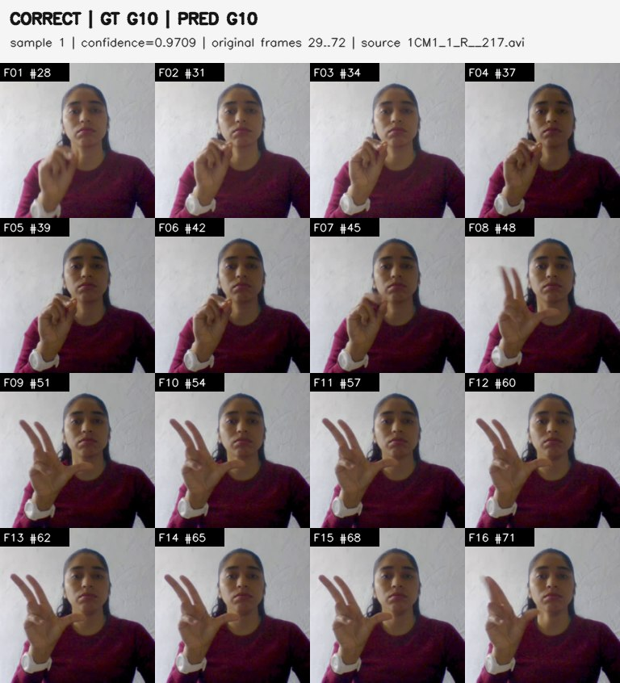
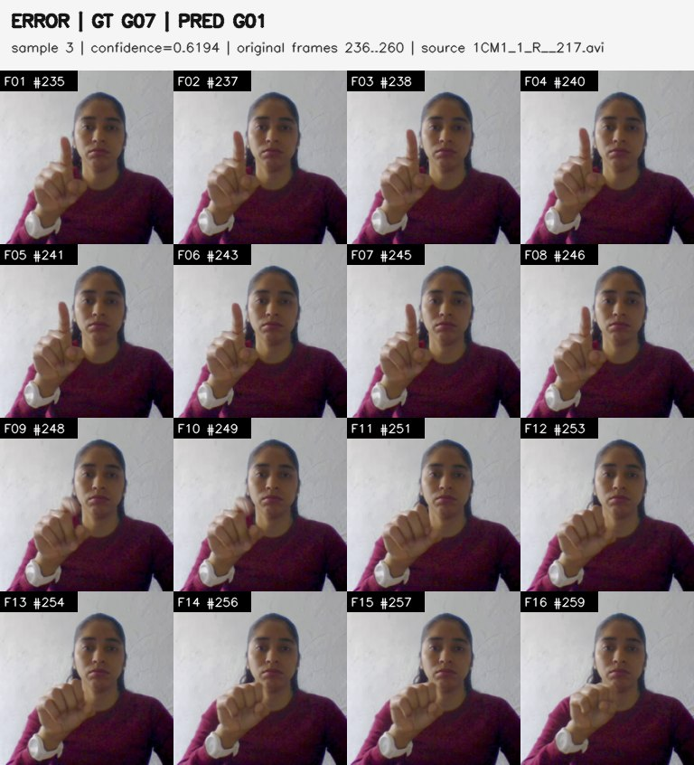
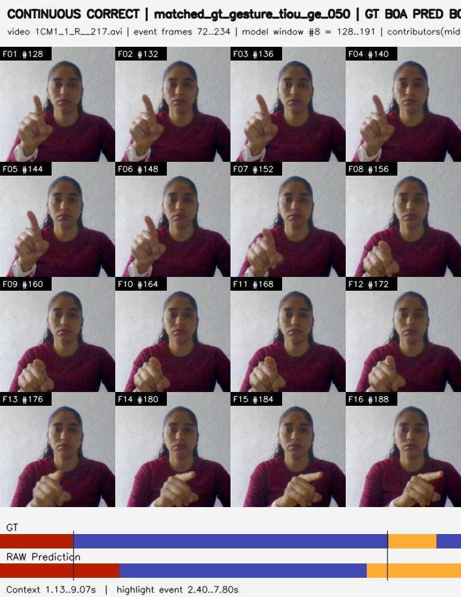
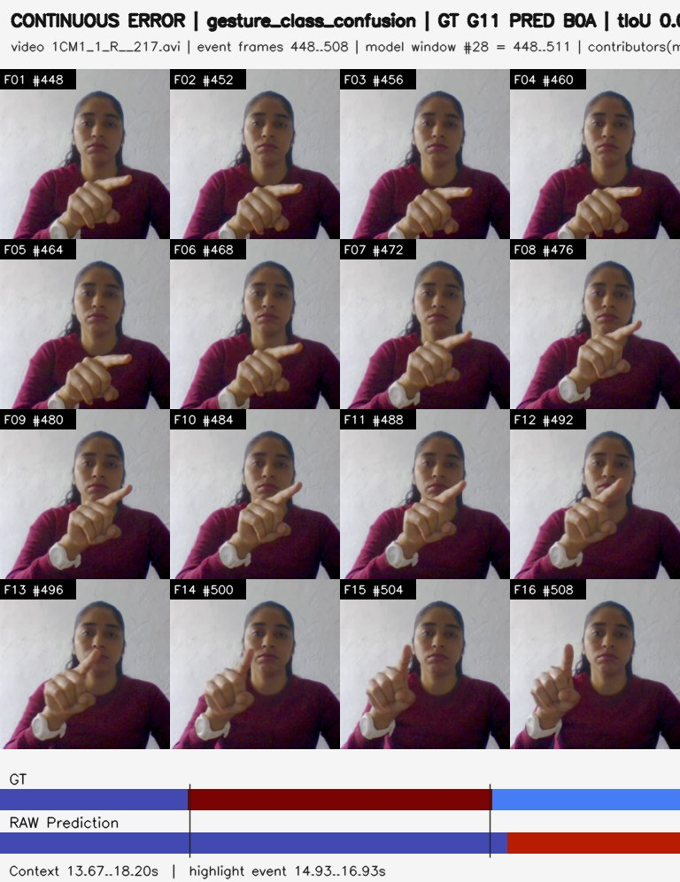
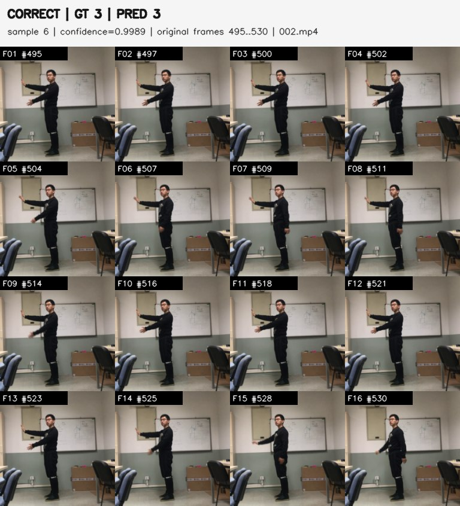
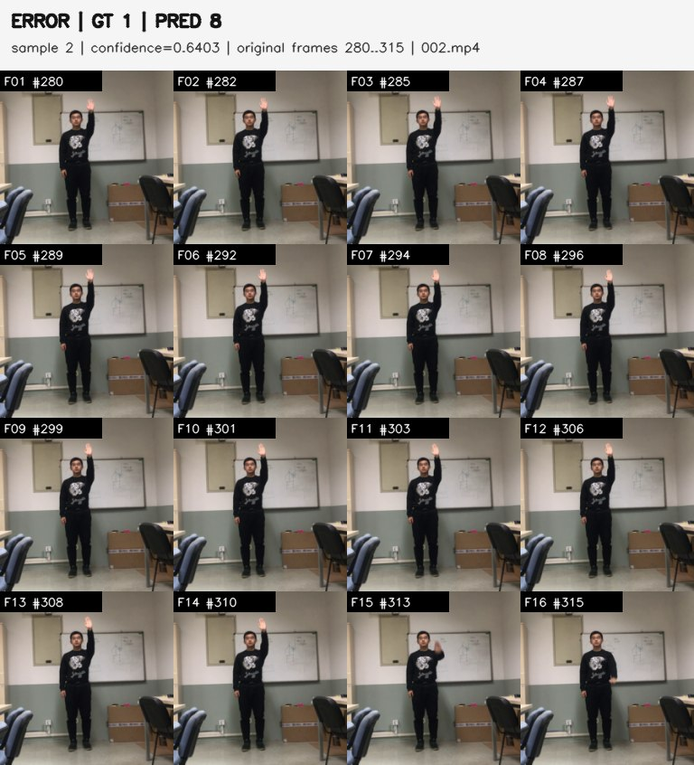
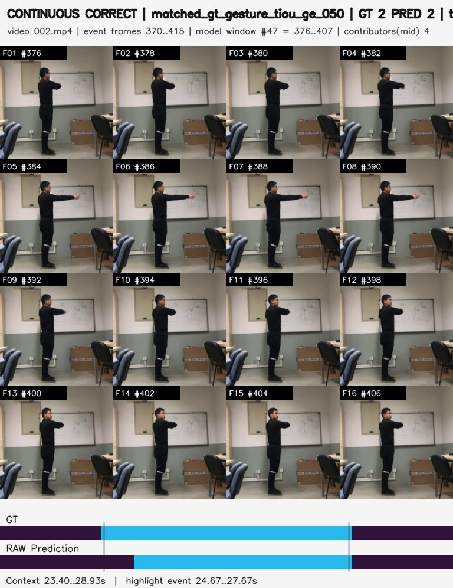
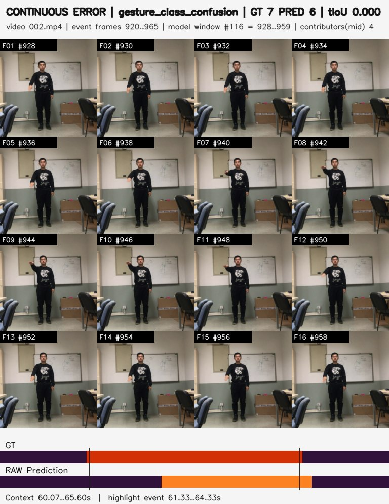
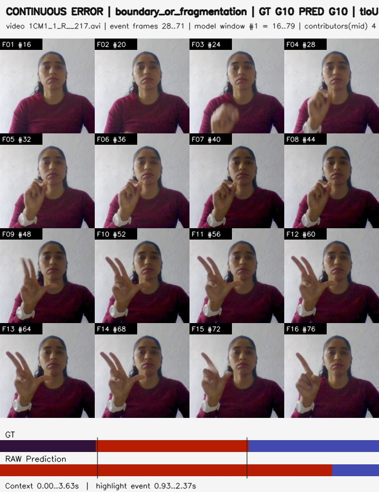
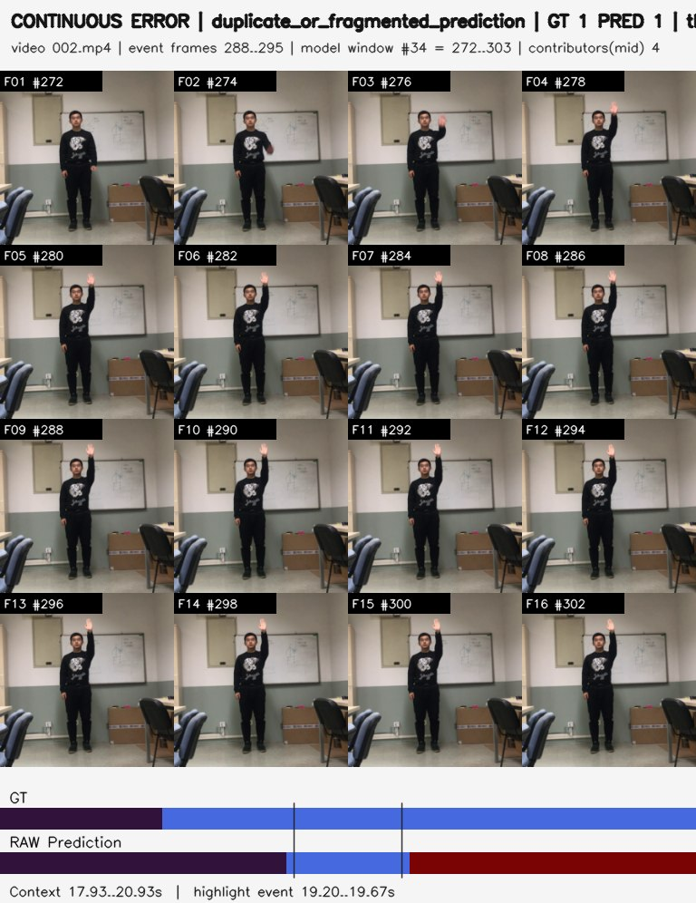

# Báo cáo nghiên cứu ngày 28/10/2026

## A. Công việc đã làm.

- Đóng gói dữ liệu **EgoEv Gesture** lên Kaggle, kiểm tra cấu trúc/split và huấn luyện mô hình **VideoMamba-Tiny**.
- Xuất keyframe cho các trường hợp dự đoán **đúng/sai** từ hai mô hình VideoMamba đã huấn luyện trên **IPN Hand** và **CTP Gesture**, đồng thời tổng hợp các chỉ số đánh giá.

### 1. Đóng gói dataset EgoEv Gesture

**Phương án chuẩn bị dữ liệu**

- Sử dụng bộ dữ liệu sự kiện **EgoEvGesture (38 lớp)** đã có trên Kaggle. Xây dựng bộ **Heterogeneous Cleaned Split v1** cố định theo subject để sử dụng thống nhất cho huấn luyện và đánh giá; **không sao chép lại dữ liệu sự kiện gốc** khi tạo split.
- **Kiểm tra trùng lặp:** đối chiếu Subject 5 và 10; với các file còn lại, sàng lọc theo kích thước, fingerprint và xác nhận trùng tuyệt đối bằng SHA-256. Kiểm tra nguy cơ file trùng xuất hiện giữa train/validation/test.

**Kết quả xử lý dữ liệu**

| Nội dung | Kết quả |
|---|---|
| Dữ liệu ban đầu | **5.398 mẫu**, 10 subjects |
| Subject trùng | **Subject 5 và 10:** 587 cặp có tên/kích thước khớp; loại **587 mẫu Subject 10** (SHA-256 của toàn bộ cặp được dẫn từ kiểm toán trước) |
| File trùng khác | **1 mẫu trùng nội bộ** |
| Dữ liệu sau làm sạch | **4.810 mẫu**, 9 subjects |
| **Train** | **2.626 mẫu**, subjects 3, 4, 5, 6, 7 |
| **Validation** | **489 mẫu**, subject 8 |
| **Test** | **1.695 mẫu**, subjects 1, 2, 9 |

**Cấu hình huấn luyện**

| Parameter | Giá trị theo notebook |
|---|---|
| Model | VideoMamba-Tiny, 38 lớp; khoảng **6,965 triệu tham số** |
| Input | Sự kiện Nx4 → 16 khung, 3 kênh, 224×224 |
| Channels | Số sự kiện dương, số sự kiện âm, tổng số sự kiện |
| Preprocessing | Chia 16 khoảng thời gian; log1p, chuẩn hóa percentile 99, ImageNet mean/std |
| Event limit | 200.000 sự kiện/mẫu |
| Hardware | 2 × Tesla T4, PyTorch DataParallel (không phải DDP) |
| Global batch / Gradient accumulation | 2 / 4 → effective batch **8** |
| Optimizer | AdamW; learning rate ban đầu **1e-4**, weight decay **0,05** |
| LR schedule | Warmup 3 epochs, cosine schedule; min LR **1e-6** |
| Drop path / Head dropout | 0,1 / 0,3 |
| Seed / Precision | 42 / FP32 (không AMP) |
| Training plan | 30 epochs; mỗi phiên tối đa 8 epochs, có resume checkpoint |

**Kết quả huấn luyện sau 16 epochs**

| Mốc | Train Accuracy | Validation Accuracy | Validation Macro-F1 |
|---|---:|---:|---:|
| Epoch 9 — checkpoint tốt nhất | 98,97% | **69,53%** | **65,26%** |
| Epoch 14 | 99,35% | 67,69% | 64,67% |
| Epoch 16 — checkpoint mới nhất | **99,31%** | **58,90%** | **53,01%** |

- Đã hoàn thành **16/60 epochs**. Kết quả tốt nhất được ghi tại **epoch 9**
- Kết thúc phiên: lưu **checkpoint-best.pth (epoch 9)**, **checkpoint-latest.pth (epoch 16)**, cấu hình và lịch sử train/validation. Checkpoint chứa trạng thái optimizer để tiếp tục.
- **Nhận xét:** Train Accuracy gần 99% nhưng Validation Accuracy dao động và giảm còn 58,90% tại epoch 16 là **dấu hiệu quá khớp hoặc chênh lệch phân phối giữa subject train và validation**. Chưa đủ cơ sở xác định nguyên nhân duy nhất. Không được trình bày 69,53% là test Accuracy.

**Notebook làm căn cứ:** [EgoEvGesture — VideoMamba-Tiny: training & resume](./egoevgesture-videomamba-tiny%20%282%29.ipynb) (mục 2: kiểm tra phân chia dữ liệu; mục 5–6: tiền xử lý và mô hình; mục 8: train/validation; mục 9–10: checkpoint và lịch sử huấn luyện). Notebook xác nhận số mẫu và subject của từng split cùng kết quả huấn luyện; **số liệu loại 587 + 1 mẫu trùng** thuộc bước kiểm toán/làm sạch trước huấn luyện và không nên xem notebook train là bằng chứng độc lập về toàn bộ thao tác loại trùng.

### 2. Xuất ra keyframe correct and error prediction để quan sát

Các hình keyframe được dùng để đối chiếu nhãn thực tế (GT) với nhãn dự đoán (Pred) và phân tích nguyên nhân nhận dạng/định vị thời gian chưa đúng. Kết quả isolated và continuous offline được báo cáo riêng do khác giao thức.

#### 2.1 IPN Hand

**Notebook gốc để tái kiểm chứng:** [VideoMamba IPN-Hand — P1 Metrics & Keyframes](./videomamba-ipn-hand-p1-metrics-keyframes-python313%20%281%29.ipynb) (mục 4: Isolated và Early GT-prefix; mục 5: Continuous RAW, segment metrics và xuất ảnh 16 frame). **Notebook đọc kết quả:** [IPN-Hand — Complete P1 Results & Keyframe Explorer](./ipn-hand-complete-videomamba-p1-results-16-fra.ipynb) (bảng class, CSV/JSON, biểu đồ và thư viện ảnh; không thực hiện inference mới).

**Giao thức đánh giá**

- Dùng checkpoint đã fine-tune, **không train lại**. Mô hình nhận **16 RGB frames/clip, 224×224, 14 lớp**.
- **Isolated**: đánh giá **1.101 đoạn** từ tập test đã chú thích, loại nhãn D0X khỏi đánh giá isolated.
- **Continuous offline**: đánh giá **52 video, 212.574 frames**, cửa sổ **64 frames**, bước trượt **16 frames** (overlap 75%); lấy 16 khung làm đầu vào cho mỗi cửa sổ.
- Thử nghiệm early recognition bằng cách cắt một phần **đoạn đã biết biên ground truth** rồi lấy mẫu lại; **không phải đo thời gian phản hồi trực tuyến**.

**Kết quả định lượng**

| Chỉ số | Giá trị |
|---|---:|
| Isolated Top-1 Accuracy | **84,65%** |
| Isolated Macro-F1 | **78,34%** |
| Continuous RAW global Frame Accuracy | **83,73%** |
| Continuous RAW global Macro-F1 | **64,40%** |
| Continuous segment F1@10 / F1@25 / F1@50 | **79,45% / 77,58% / 69,91%** |
| Continuous mean edit score (MS-TCN convention) | **74,38%** |
| Mean temporal overlap (RAW, per-video) | **49,11%** |

**Độ chính xác nhận dạng khi chỉ quan sát một phần đoạn cử chỉ:**

| Tỷ lệ quan sát | 10% | 20% | 50% | 75% | 100% |
|---|---:|---:|---:|---:|---:|
| Accuracy | 38,69% | 53,77% | 76,11% | 83,83% | 84,65% |

- Các lớp dễ nhầm hơn gồm **G02 (25,00%)**, **G01 (42,31%)** và **G08 (51,92%)**, dựa trên isolated per-class accuracy.
- Đã tạo hình gồm **đúng 16 khung được đưa vào mô hình**, kèm nhãn GT/Pred; isolated: **932 đúng, 169 sai**. Continuous: xuất **820 trường hợp ghép đúng, 706 trường hợp lỗi/không ghép được**, theo tiêu chí ghép nhãn và temporal IoU ≥ 0,5.

#### 2.2 CTP Gesture

**Notebook gốc để tái kiểm chứng:** [VideoMamba CTPGesture — P1 Metrics & Keyframes](./videomamba-ctpgesture-p1-metrics-keyframes-python3%20%283%29.ipynb) (mục 6: Isolated, Early GT-prefix và xuất ảnh; mục 7: Continuous RAW, F1 theo tIoU, sai lệch biên và xuất ảnh 16 frame). **Notebook đọc kết quả:** [CTPGesture — Complete P1 Results & Keyframe Explorer](./ctpgesture-v1-complete-videomamba-p1-results-1.ipynb) (kiểm kê Output, bảng metric và thư viện ảnh; không thực hiện inference mới).

**Giao thức đánh giá**

- Dùng checkpoint VideoMamba-Tiny **epoch 17**, **6.959.817 tham số**, **16 RGB frames/clip, 224×224**, **9 lớp**.
- Kiểm tra **11 video test chính thức**, **67.356 frames**, **1.728 GT segments** (trong đó 869 no-gesture và 859 gesture).
- Isolated: mỗi đoạn được gán nhãn là một clip. Continuous offline: cửa sổ **32 frames, stride 8**, overlap 75%, tổng **8.392 cửa sổ**; ghép xác suất dự đoán thành nhãn theo frame.
- Môi trường: Python 3.13.15, PyTorch 2.11.0+cu128, CUDA 12.8, Tesla T4, native Mamba CUDA; kiểm thử checkpoint/model forward đã **PASS**.

**Kết quả định lượng**

| Chỉ số | Giá trị |
|---|---:|
| Isolated Accuracy — 9 lớp | **98,55%** |
| Isolated Macro-F1 — 9 lớp | **97,96%** |
| Isolated gesture-only Accuracy — GT nhãn 1–8 | **98,02%** |
| Continuous RAW global Frame Accuracy | **83,98%** |
| Continuous RAW global Macro-F1 | **80,61%** |
| Continuous RAW mean per-video Frame Accuracy | **83,50%** |
| Continuous segment F1@10 / F1@25 / F1@50 | **96,05% / 94,75% / 85,55%** |
| Mean temporal overlap | **65,32%** |
| Mean gesture recall | **94,80%** |
| Mean matched onset / offset absolute error (tIoU ≥ 0,5) | **0,290 s / 0,446 s** |

**Early isolated Accuracy (9 lớp, dựa trên GT-prefix):**

| Tỷ lệ quan sát | 10% | 20% | 50% | 75% | 100% |
|---|---:|---:|---:|---:|---:|
| Accuracy | 86,05% | 93,17% | 97,57% | 98,38% | 98,55% |

**Keyframe dự đoán đúng và sai**

- **Isolated:** xuất hình **1.728/1.728 clips**, gồm **1.703 đúng** và **25 sai**, không lỗi giải mã.
- **Continuous:** xuất **970/970 trường hợp**, gồm **725 đúng** và **245 lỗi**; mỗi hình chứa 16 khung đại diện từ cửa sổ mô hình cùng timeline GT/Pred. Đếm trường hợp continuous dựa trên ghép một-một cùng lớp với temporal IoU ≥ 0,5, **không phải 970 video độc lập**.
- Ví dụ isolated: [dự đoán đúng](./ctpResult/ctpgesture_videomamba_p1_evaluation/p1_metric_audit/isolated_16frame/correct/correct_00001.jpg) · [dự đoán sai](./ctpResult/ctpgesture_videomamba_p1_evaluation/p1_metric_audit/isolated_16frame/error/error_00002.jpg).
- Ví dụ continuous: [trường hợp đúng](./ctpResult/ctpgesture_videomamba_p1_evaluation/p1_metric_audit/continuous_16frame_timeline/correct/correct_00004.jpg) · [trường hợp lỗi](./ctpResult/ctpgesture_videomamba_p1_evaluation/p1_metric_audit/continuous_16frame_timeline/error/error_00001.jpg).
- Dữ liệu phục vụ tái kiểm chứng gồm classification report, isolated predictions, per-video CSV, early accuracy, phân tích biên đoạn và các bảng manifest từng trường hợp.

### 3. Minh họa định tính từ các kết quả keyframe đã xuất

Các ảnh dưới đây được lấy **trực tiếp từ hai thư mục `ipnResult/` và `ctpResult/`** đã lưu trên repository. Mỗi ảnh ghép **16 frame đầu vào mô hình**; ảnh Continuous còn kèm dòng thời gian GT/Pred. Nhãn và chỉ số trong chú thích được đối chiếu theo `isolated_all_samples_index.csv` hoặc `continuous_all_events_index.csv`, **không suy đoán nhãn chỉ từ hình ảnh**. Các ví dụ có tính minh họa, không thay thế thống kê toàn bộ tập test.

#### 3.1 IPN Hand — Isolated classification

*Nguồn phương pháp và nhãn:* [Notebook đánh giá IPN-Hand — mục 4](./videomamba-ipn-hand-p1-metrics-keyframes-python313%20%281%29.ipynb); [notebook đối chiếu keyframe và mã lớp](./ipn-hand-complete-videomamba-p1-results-16-fra.ipynb); [CSV chỉ mục Isolated](./ipnResult/p1_ipn_re_evaluation/isolated_16frame/isolated_all_samples_index.csv).

| Phân loại đúng | Nhầm nhãn cử chỉ |
|:---:|:---:|
|  |  |
| **GT G10 — Zoom in → Pred G10 — Zoom in**. Video `1CM1_1_R__217.avi`, frames 29–72 (nhãn 1-based); độ tin cậy **97,09%**. | **GT G07 — Open twice → Pred G01 — Click with one finger**. Cùng video, frames 236–260; độ tin cậy của lớp dự đoán **61,94%**. |

**Nhận xét:** ví dụ sai là lỗi **nhầm lớp** ngay cả khi đoạn cử chỉ được cắt theo biên GT; điều này khác với lỗi xác định thời điểm bắt đầu/kết thúc trong bài toán Continuous.

#### 3.2 IPN Hand — Continuous offline

*Nguồn phương pháp và nhãn:* [Notebook đánh giá IPN-Hand — mục 5](./videomamba-ipn-hand-p1-metrics-keyframes-python313%20%281%29.ipynb); [notebook đối chiếu keyframe và lỗi](./ipn-hand-complete-videomamba-p1-results-16-fra.ipynb); [CSV chỉ mục Continuous](./ipnResult/p1_ipn_re_evaluation/continuous_16frame_timeline/continuous_all_events_index.csv).

| Phát hiện và ghép đoạn đúng | Lỗi nhầm lớp |
|:---:|:---:|
|  |  |
| **GT B0A — Pointing with one finger → Pred B0A**, frames 72–234 (0-based), **tIoU = 0,7853**; được ghép đúng theo ngưỡng 0,50. | **GT G11 — Zoom out → Pred B0A — Pointing with one finger**, frames 448–508 (0-based); **tIoU = 0** cho cặp lớp cùng nhãn, thuộc nhóm `gesture_class_confusion`. |

#### 3.3 CTPGesture_v1 — Isolated classification

*Nguồn phương pháp và nhãn:* [Notebook đánh giá CTPGesture — mục 6](./videomamba-ctpgesture-p1-metrics-keyframes-python3%20%283%29.ipynb); [notebook đối chiếu keyframe và mã lớp](./ctpgesture-v1-complete-videomamba-p1-results-1.ipynb); [CSV chỉ mục Isolated](./ctpResult/ctpgesture_videomamba_p1_evaluation/p1_metric_audit/isolated_16frame/isolated_all_samples_index.csv).

| Phân loại đúng | Nhầm nhãn cử chỉ |
|:---:|:---:|
|  |  |
| Video `002.mp4`, đoạn `002_seg0005`, frames 495–530: **GT 3 — Left Turn → Pred 3 — Left Turn**, độ tin cậy **99,89%**. | Video `002.mp4`, đoạn `002_seg0001`, frames 280–315: **GT 1 — Stop → Pred 8 — Pull Over**, độ tin cậy lớp dự đoán **64,03%**. |

#### 3.4 CTPGesture_v1 — Continuous offline

*Nguồn phương pháp và nhãn:* [Notebook đánh giá CTPGesture — mục 7](./videomamba-ctpgesture-p1-metrics-keyframes-python3%20%283%29.ipynb); [notebook đối chiếu keyframe và lỗi](./ctpgesture-v1-complete-videomamba-p1-results-1.ipynb); [CSV chỉ mục Continuous](./ctpResult/ctpgesture_videomamba_p1_evaluation/p1_metric_audit/continuous_16frame_timeline/continuous_all_events_index.csv).

| Phát hiện và ghép đoạn đúng | Lỗi nhầm lớp |
|:---:|:---:|
|  |  |
| Video `002.mp4`, frames 370–415: **GT 2 — Forward → Pred 2 — Forward**, **tIoU = 0,8696**. | Video `002.mp4`, frames 920–965: **GT 7 — Slow Down → Pred 6 — Lane Changing**, **tIoU = 0**, loại `gesture_class_confusion`. |

#### 3.5 Khi lớp dự đoán đúng nhưng vẫn bị tính là lỗi Continuous

*Nguồn định nghĩa lỗi ranh giới và ghép đoạn:* [IPN-Hand — P1 Metrics & Keyframes](./videomamba-ipn-hand-p1-metrics-keyframes-python313%20%281%29.ipynb) và [CTPGesture — P1 Metrics & Keyframes](./videomamba-ctpgesture-p1-metrics-keyframes-python3%20%283%29.ipynb); mã loại lỗi và tIoU được đối chiếu trực tiếp với hai CSV chỉ mục ở bảng nguồn bên dưới.

| IPN Hand: sai biên đoạn | CTPGesture: phân mảnh/dự đoán trùng |
|:---:|:---:|
|  |  |
| Video `1CM1_1_R__217.avi`, frames 28–71: **GT G10 → Pred G10**, nhưng **tIoU = 0,4583 < 0,50**; loại `boundary_or_fragmentation`. | Video `002.mp4`, frames 288–295: **GT 1 — Stop → Pred 1 — Stop**, nhưng **tIoU = 0,2222 < 0,50**; dự đoán dư/phân mảnh (`duplicate_or_fragmented_prediction`). |

**Nhận xét chung:** tỷ lệ đúng/sai ở **Isolated** phản ánh phân loại lớp trong đoạn đã biết biên; còn ở **Continuous**, một trường hợp bị đánh dấu lỗi có thể do sai lớp, bỏ sót, xuất hiện đoạn dư hoặc **tIoU thấp dù GT và Pred cùng lớp**. Vì vậy, số ảnh `error/` trong Continuous không được diễn giải trực tiếp thành số lần phân loại sai lớp.

**Nguồn để kiểm tra đầy đủ từng hình:**

| Dataset | Chỉ mục Isolated | Chỉ mục Continuous | Thư mục ảnh |
|---|---|---|---|
| IPN Hand | [CSV Isolated](./ipnResult/p1_ipn_re_evaluation/isolated_16frame/isolated_all_samples_index.csv) | [CSV Continuous](./ipnResult/p1_ipn_re_evaluation/continuous_16frame_timeline/continuous_all_events_index.csv) | [ipnResult](./ipnResult/) |
| CTPGesture_v1 | [CSV Isolated](./ctpResult/ctpgesture_videomamba_p1_evaluation/p1_metric_audit/isolated_16frame/isolated_all_samples_index.csv) | [CSV Continuous](./ctpResult/ctpgesture_videomamba_p1_evaluation/p1_metric_audit/continuous_16frame_timeline/continuous_all_events_index.csv) | [ctpResult](./ctpResult/) |

> Ghi chú phương pháp: các hình Continuous là kết quả đánh giá **offline với cửa sổ chồng lấn**, không phải đánh giá độ trễ lệnh trực tuyến (Online Early@10 / TTC).

### 4. Danh mục notebook nguồn và khả năng kiểm chứng

| Notebook trong `Research_Report/261028/` | Vai trò | Những kết quả trong báo cáo có thể đối chiếu |
|---|---|---|
| [EgoEvGesture — VideoMamba-Tiny](./egoevgesture-videomamba-tiny%20%282%29.ipynb) | Notebook huấn luyện, resume, kiểm tra split | Số mẫu train/val/test, subject split, cấu hình mô hình, lịch sử epoch, checkpoint; không thay thế báo cáo kiểm toán file trùng |
| [VideoMamba IPN-Hand — P1 Metrics & Keyframes](./videomamba-ipn-hand-p1-metrics-keyframes-python313%20%281%29.ipynb) | **Notebook tính toán gốc** | Giao thức 16 frame, 1.101 Isolated, Early GT-prefix, 52 video Continuous, metric theo lớp/đoạn, sinh ảnh |
| [VideoMamba CTPGesture — P1 Metrics & Keyframes](./videomamba-ctpgesture-p1-metrics-keyframes-python3%20%283%29.ipynb) | **Notebook tính toán gốc** | 1.728 Isolated, Early GT-prefix, 11 video Continuous, tIoU/F1, boundary diagnostics, sinh ảnh |
| [IPN-Hand — Complete P1 Results](./ipn-hand-complete-videomamba-p1-results-16-fra.ipynb) | Notebook **đọc và trình bày Output** | Bảng mã lớp, thống kê CSV/JSON, đối chiếu GT/Pred và ảnh minh họa IPN |
| [CTPGesture — Complete P1 Results](./ctpgesture-v1-complete-videomamba-p1-results-1.ipynb) | Notebook **đọc và trình bày Output** | Bảng mã lớp, thống kê CSV/JSON, đối chiếu GT/Pred và ảnh minh họa CTP |

**Thứ tự ưu tiên nguồn:** Khi dẫn chứng **quy trình và công thức đánh giá**, tham khảo notebook tính toán gốc; khi dẫn chứng **con số và từng trường hợp đúng/sai**, đối chiếu thêm bảng CSV/JSON và ảnh trong `ipnResult/`, `ctpResult/`. Hai notebook *Complete Results* là công cụ trình bày lại các tệp đã xuất, **không phải lần thử nghiệm độc lập**.

## B. Khó khăn
- Không
## C. Công việc tiếp theo
